<p align="center">
  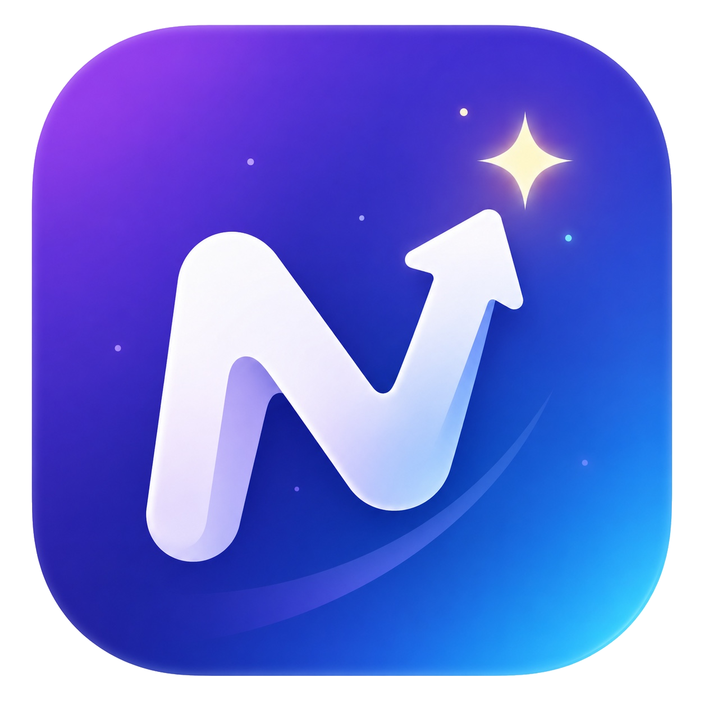
</p>

<h1 align="center">Nudge 輕推式自律養成平台</h1>

<p align="center">
  用「輕推」而不是逼迫，幫你養成自律習慣的 Flutter App ＋ 網頁後台<br/>
  畢業專題 B06
</p>

---

## 📌 專案簡介

很多自律 App 只會記錄，不會陪伴。Nudge 把**任務計分、專注計時、健康資料、朋友互相督促、角色養成**整合在一起：完成任務賺自律幣，用自律幣幫角色換裝，在自習室裡跟朋友一起專注，讓「堅持下去」這件事變得有回饋、有人陪。

---

## 📸 App 畫面

<table>
<tr><td align="center">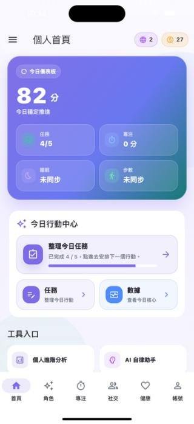<br/><sub>個人首頁</sub></td><td align="center">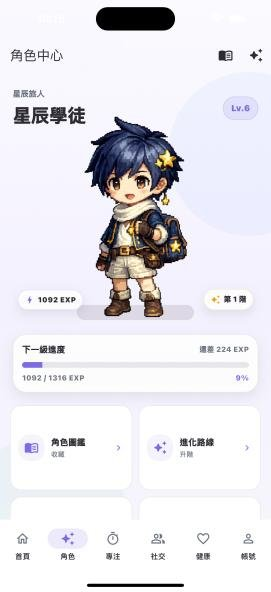<br/><sub>角色中心</sub></td><td align="center">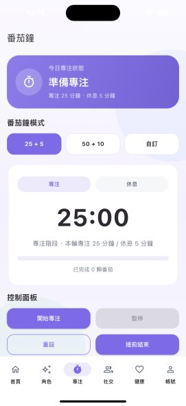<br/><sub>番茄鐘專注</sub></td><td align="center">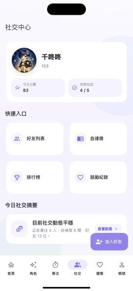<br/><sub>社交中心</sub></td></tr>
<tr><td align="center">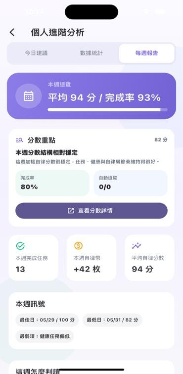<br/><sub>個人進階分析</sub></td><td align="center">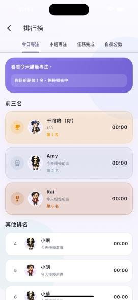<br/><sub>排行榜</sub></td><td align="center">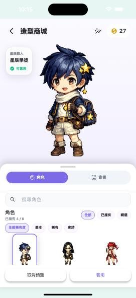<br/><sub>造型商城</sub></td><td align="center">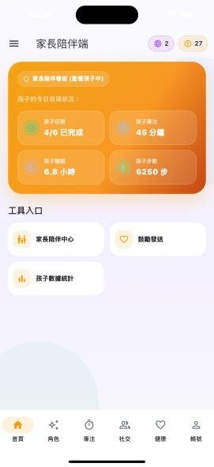<br/><sub>家長陪伴</sub></td></tr>
</table>

> App 截圖取自專題簡報（`docs/專題文件/B06_Nudge_簡報.pdf`）。

---

## ✨ 核心功能

| 類別 | 功能 |
|---|---|
| ✅ 任務與計分 | 手動、截止日、自動追蹤三種任務；加權計分並發放自律幣；計分邏輯有專頁說明 |
| ⏱️ 專注 | 專注計時器與專注歷史 |
| ❤️ 健康 | 串接 Apple Health／Android Health Connect，自動追蹤睡眠、步數、運動 |
| 👥 社交督促 | 好友（QR Code 加好友）、排行榜、鼓勵卡片、自律房間（房間目標、聊天、審核）、線上自習室 |
| 🧑‍🎨 角色養成 | 角色編輯器、服裝商店與衣櫃、角色進化、圖鑑、公開個人頁 |
| 📊 紀錄與分析 | 每日紀錄、行事曆、統計、週報、徽章、個人分析 |
| 🤖 AI 助理 | 以 Firebase AI（Gemini）提供今日建議與對話協助 |
| 💌 情感設計 | 給未來的信、時光膠囊 |
| 🛡️ 守護者中心 | 家長／守護者只看趨勢資料，可設定共同目標與權限，也能隨時解除連結 |
| 🔒 隱私 | 健康與活動等敏感資料的隱私與資料管理頁 |

### 🌐 網頁後台（`web_dashboard/`）

手機不適合做的事交給網頁：長期趨勢報表、守護者中心、團體／班級挑戰與排名、營運後台（房間審核、商店上架）、匿名化研究分析、「自律星球」視覺化，以及畢業展示用的簡報模式。說明見 [docs/web_dashboard_and_notifications.md](docs/web_dashboard_and_notifications.md)。

| 首頁 | 網頁後台總覽 |
|---|---|
| 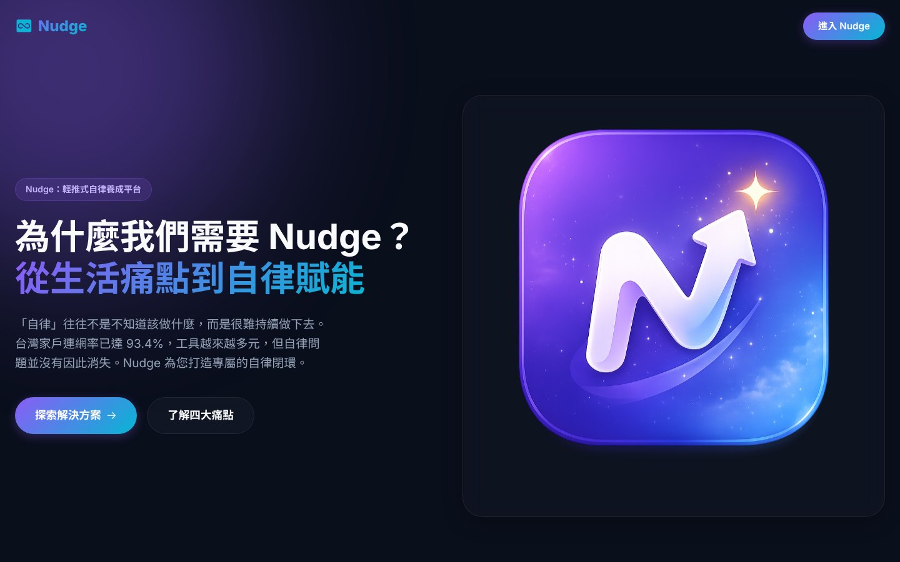 | 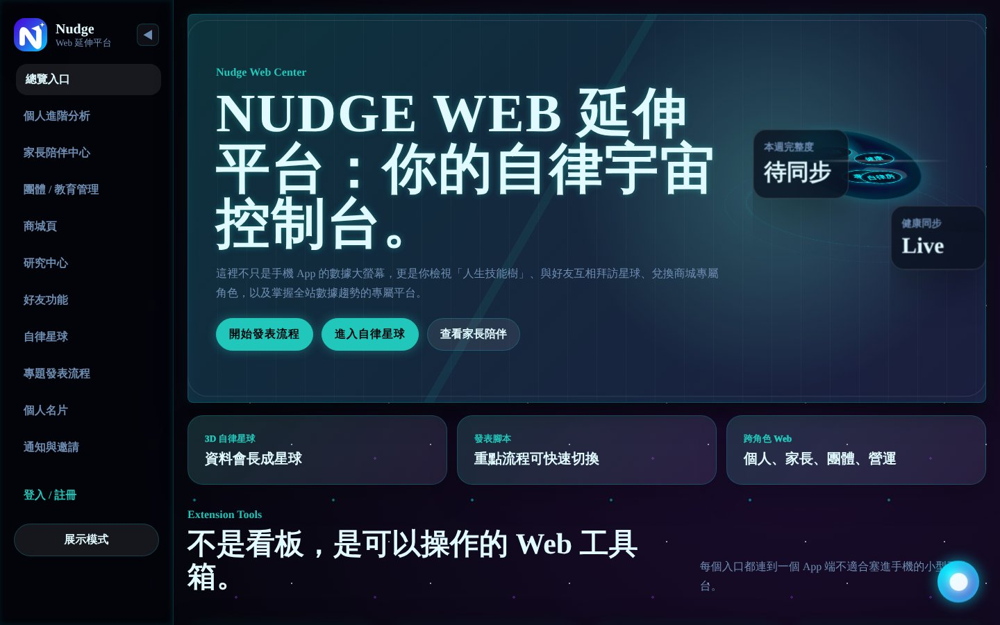 |
| **個人進階分析：月／年度趨勢** | **人生技能樹** |
| 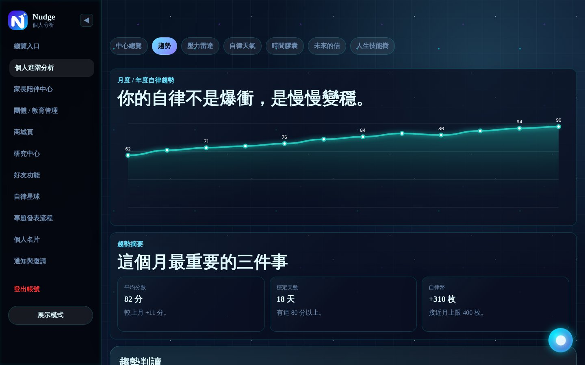 | 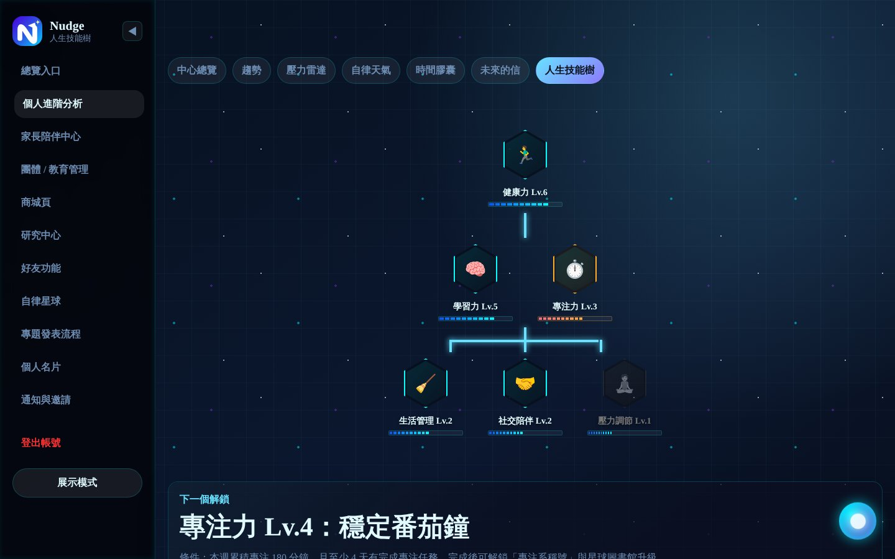 |
| **自律星球** | **家長陪伴中心** |
| 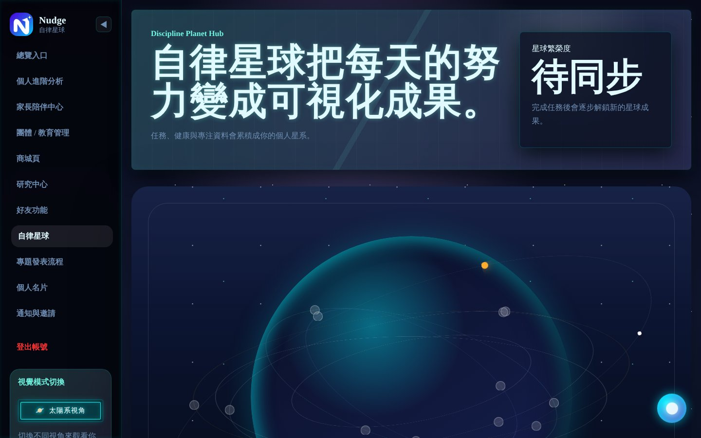 | 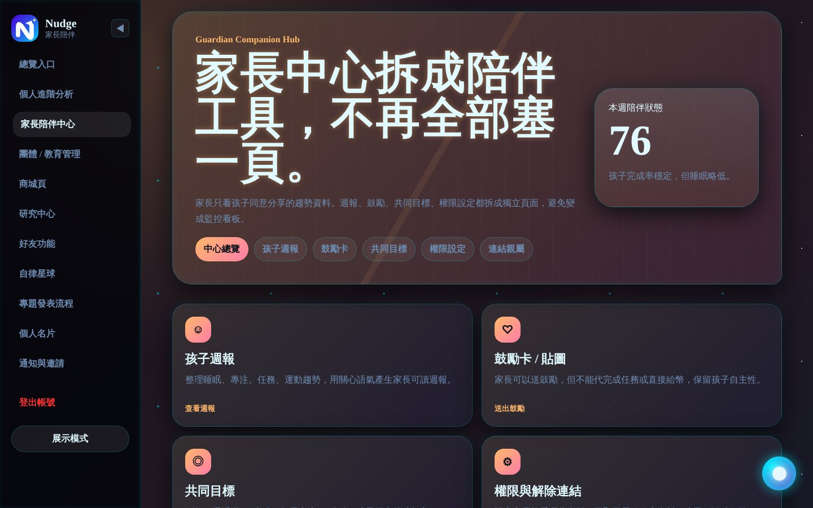 |
| **研究中心：匿名化全站數據** | **商城頁** |
| 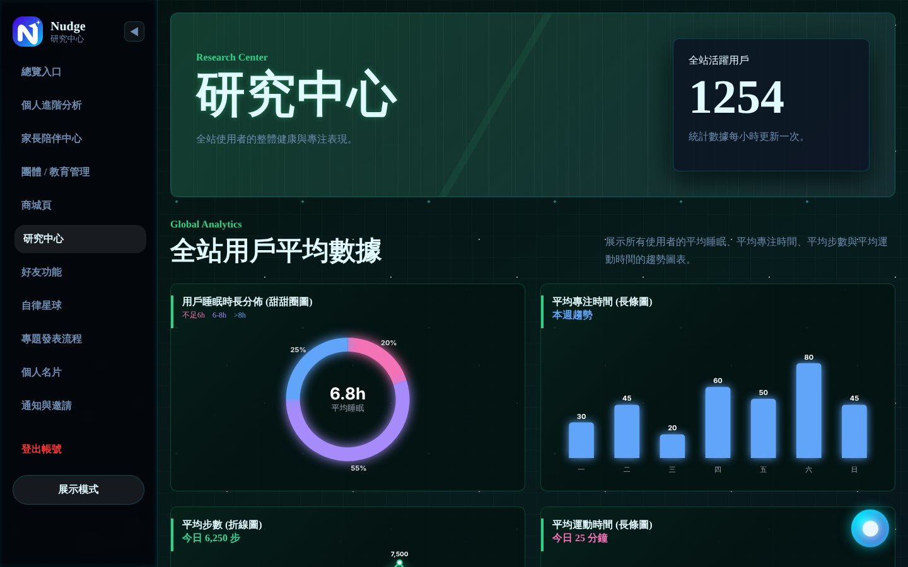 | 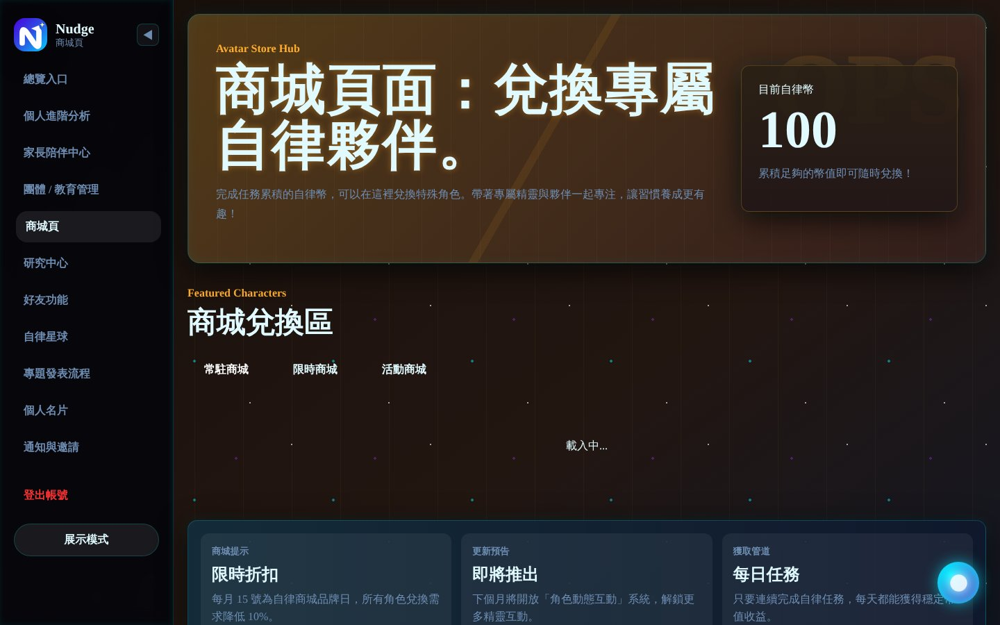 |

> 網頁後台截圖在本機以離線方式執行（未連 Firebase），畫面上的數字為頁面內建的展示資料。

---

## 🏗️ 系統架構

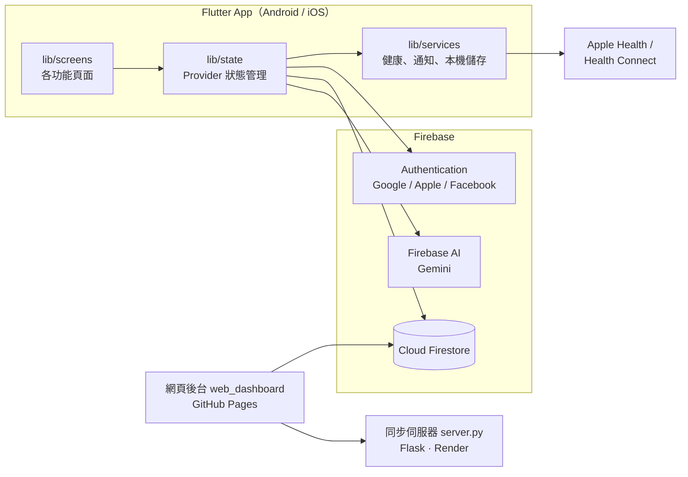

---

## 🧰 技術棧

- **App**：Flutter、Dart、Provider
- **後端服務**：Firebase Authentication、Cloud Firestore、Firebase AI（Gemini）
- **裝置整合**：Apple Health／Health Connect、本機通知、QR Code 掃描
- **網頁後台**：HTML／CSS／JavaScript，部署在 GitHub Pages
- **同步伺服器**：Python Flask + Gunicorn，部署在 Render（`render.yaml`）

---

## 🚀 開發環境設定

### 1. Firebase 設定檔

為了避免金鑰外流，以下 Firebase 設定檔不放在 repo 中（已列入 `.gitignore`）：

- `lib/firebase_options.dart`
- `android/app/google-services.json`
- `ios/Runner/GoogleService-Info.plist`

本機開發請執行 `flutterfire configure` 產生，或向組員取得。

### 2. 執行 App

```bash
flutter pub get
flutter analyze
flutter test
flutter run
```

### 3. 網頁後台

`web_dashboard/` 的金鑰以 `__FIREBASE_WEB_API_KEY__` 占位，推送到 `main` 時由 GitHub Actions（`.github/workflows/pages.yml`）從 repo secret `FIREBASE_WEB_API_KEY` 注入並部署到 GitHub Pages。本機測試時請自行替換占位字串。

同步伺服器本機執行：

```bash
cd web_dashboard
pip install -r requirements.txt
python server.py
```

### 4. Firestore 種子資料（選用）

需要先從 Firebase Console →「專案設定」→「服務帳戶」下載金鑰，存成專案根目錄的 `firebase-service-account.json`（**不要 commit**）。

```bash
cd scripts
npm install
node seed_firestore.js
```

---

## 📁 專案結構

```text
.
├─ lib/
│  ├─ main.dart
│  ├─ models/        # 任務、使用者、角色、自習室等資料模型
│  ├─ screens/       # 各功能頁面
│  ├─ services/      # 健康資料、通知、本機儲存
│  ├─ state/         # App 狀態（Provider）
│  ├─ theme/         # 主題樣式
│  └─ widgets/       # 共用元件
├─ assets/           # 角色素材、品牌圖示
├─ web_dashboard/    # 網頁後台與同步伺服器
├─ scripts/          # Firestore 種子資料、圖示產生
├─ tool/             # 角色素材處理工具
├─ firestore.rules   # Firestore 安全規則
├─ docs/             # 設計文件與專題文件
└─ android/ ios/ web/ macos/ linux/ windows/
```

---

## 📚 專題文件

放在 [`docs/專題文件/`](docs/專題文件/)：專題簡介、系統概述、簡報、初審回應表。
